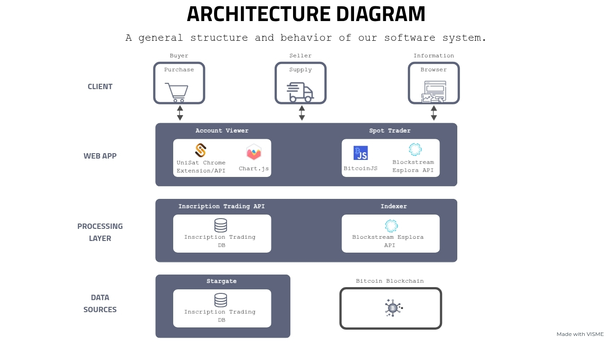

<!-- PROJECT LOGO -->

<div align="center">
  

  <h3 align="center" style="font-size: 2.1em; font-weight: bolder;">Zorro</h3>

  <p align="center">
    Exploring Bitcoin trading through BRC-20 tokens and NFTs.
    <br />
    <br />
    <a href="https://github.com/ninoestrada/Zorro/issues/new">Report Bug</a>
    ·
    <a href="https://github.com/ninoestrada/Zorro/issues/new">Request Feature</a>
  </p>

</div>


<!-- ABOUT THE PROJECT -->

## 📖 About the Project

**Zorro** is a Bitcoin spot trading prototype that brings together BRC-20 tokens, Bitcoin NFTs, and portfolio management in one interface. Users can explore digital assets, connect their UniSat wallet, view market orders, and interact with buy and sell interfaces.

The project aims to make cryptocurrency trading more approachable, particularly for people unfamiliar with blockchain technology and digital wallets. It combines a React frontend with a separate backend API for managing orders, tracking marketplace activity, and coordinating trades on Bitcoin Testnet.

This repository contains the frontend application. The backend is available in the [Zorro-API](https://github.com/ninoestrada/Zorro-API) repository.

### ✨ Features

- **BRC-20 Trading:** Browse BRC-20 tokens, view market orders, and submit buy and sell orders.
- **NFT Marketplace:** Explore Bitcoin NFTs, view inscription details, and access listing and purchase interfaces.
- **Wallet Integration:** Connect a UniSat wallet to view balances and initiate transactions.
- **Portfolio Dashboard:** View BRC-20 holdings, open orders, and transaction records from a personal dashboard.
- **Interactive Charts:** Visualize token holdings and trading activity.
- **Token Details:** Select tokens to view detailed information, including pricing, supply, minting activity, and available trading actions.

<!-- DEFINITION -->

## ₿ What Are BRC-20 Tokens and Bitcoin NFTs?

**BRC-20 tokens** are fungible digital assets created using Bitcoin Ordinal inscriptions. They use inscription data to represent token creation, minting, and transfers.

**Bitcoin NFTs** are unique digital collectibles created through inscriptions on the Bitcoin blockchain. These inscriptions can contain images, text, and other digital content.

### **🛠️ Tech Stack**

|                    Frontend                     |                     Backend                     |
| :---------------------------------------------: | :---------------------------------------------: |
| [![TypeScript][TypeScript.com]][TypeScript-url] |     [![Node.js][Node.js.com]][Node.js-url]      |
|        [![React][React.com]][React-url]         | [![TypeScript][TypeScript.com]][TypeScript-url] |
|  [![Ant Design][AntDesign.com]][AntDesign-url]  |     [![Express][Express.com]][Express-url]      |
|        [![Axios][Axios.com]][Axios-url]         |        [![MySQL][MySQL.com]][MySQL-url]         |
|     [![Chart.js][ChartJS.com]][ChartJS-url]     |  [![BitcoinJS][BitcoinJS.com]][BitcoinJS-url]   |

The backend technologies are part of the separate [Zorro-API](https://github.com/ninoestrada/Zorro-API) repository.

## 🏗️ Architecture

### System Architecture

The diagram below illustrates Zorro's system design, including the frontend, backend API, blockchain integrations, and a separate inscription indexer.



### System Context

The context diagram illustrates how buyers and sellers interact with the trading platform through their Bitcoin wallets.


## 🧪 Development & Testing

To test the trading platform, we created digital assets on Bitcoin Testnet, including a custom BRC-20 token called **ZORO** and a Bitcoin NFT featuring the project's original logo.

The ZORO token was deployed with a maximum supply of 21 million tokens and a minting limit of 1,000 tokens. These assets allowed us to explore token deployment, wallet interactions, asset holdings, and the trading workflow.

**ZORO BRC-20 Token:** [View token](https://testnet.unisat.io/brc20/ZORO)

**Zorro NFT:** [View NFT](https://testnet.unisat.io/inscription/2ceb19ae6f8467b4fb2dec00739dfe77b45b8d533904b14a87f29580600440dfi0)

_These assets were created on Bitcoin Testnet for development and testing and have no monetary value._

<!-- GETTING STARTED -->

## 📦 Getting Started

### **💾 Installation**

**Prerequisites:** Node.js and npm installed on your machine, along with the UniSat wallet browser extension for testing wallet interactions.

Zorro consists of separate frontend and backend applications. Both must be configured and running to use the trading interface.

1. Clone the frontend repository and navigate to the project directory.

   ```sh
   git clone https://github.com/ninoestrada/Zorro.git
   cd Zorro
   ```

2. Install dependencies.

   ```sh
   npm install
   ```

3. Create a `.env` file in the project root and configure the frontend environment variables.

   ```env
   REACT_APP_EXCHANGE_WALLET=your-exchange-wallet-address
   ```

   The frontend uses this environment variable to configure the exchange wallet address. React environment variables prefixed with `REACT_APP_` are exposed in the browser, so private credentials and wallet secrets should not be stored there.

4. Set up the [Zorro-API](https://github.com/ninoestrada/Zorro-API) backend following its installation instructions. The API requires a MySQL database and additional environment configuration.

5. Start the backend API before running the frontend. The API runs on port 3000 by default.

### **▶️ Running the Program**

```sh
npm start
```

Open [http://localhost:3001](http://localhost:3001) in your browser.

The application requires the UniSat wallet browser extension configured for Bitcoin Testnet. To test trading transactions, the wallet must also contain sufficient testnet BTC to cover payments and network fees.

Order fulfillment requires a separate matching process provided by the Zorro-API.

<!-- PROJECT REPOSITORIES -->

## 📁 Project Repositories

- **[Zorro](https://github.com/ninoestrada/Zorro)** — Frontend application built with React and TypeScript.
- **[Zorro-API](https://github.com/ninoestrada/Zorro-API)** — Backend API built with Node.js, Express, and MySQL, supporting trading orders, transaction records, and order matching.

## 👥 Contributors

<table>
  <tr>
    <td align="center">
      <a href="https://github.com/ninoestrada">
        
        <br />
        <sub><b>Nino Estrada</b></sub>
      </a>
    </td>
    <td align="center">
      <a href="https://github.com/rnayakusf">
        
        <br />
        <sub><b>Ritvik Nayak</b></sub>
      </a>
    </td>
    <td align="center">
      <a href="https://github.com/RodolfoSevilla">
        
        <br />
        <sub><b>Rodolfo Sevilla</b></sub>
      </a>
    </td>
  </tr>
</table>

### Project Sponsor & Advisor

<a href="https://github.com/johnqh">
  
  <br />
  <sub><b>John Huang</b></sub>
</a>

### My Contributions

- Developed frontend features using React and TypeScript, including interactive Chart.js visualizations for token holdings and trading activity.
- Integrated UniSat wallet functionality to enable wallet connections, balance retrieval, and Bitcoin transaction initiation.
- Implemented backend trading functionality to process buy and sell orders and coordinate Bitcoin transactions.
- Built a blockchain indexer and contributed to the backend API, adapting the platform to an alternative indexing solution.
- Designed the user interface in Figma and translated the designs into functional frontend components.
- Documented the system architecture and trading workflows through architecture and data flow diagrams.
- Created the Zorro logo, ZORO BRC-20 token, and custom Bitcoin NFTs to support branding, development, and testing.

<!------- MARKDOWN LINKS & IMAGES ------->

[TypeScript.com]: https://img.shields.io/badge/TypeScript-3178C6?style=for-the-badge&logo=typescript&logoColor=white
[TypeScript-url]: https://www.typescriptlang.org/
[React.com]: https://img.shields.io/badge/React-20232A?style=for-the-badge&logo=react&logoColor=61DAFB
[React-url]: https://react.dev/
[AntDesign.com]: https://img.shields.io/badge/Ant_Design-0170FE?style=for-the-badge&logo=antdesign&logoColor=white
[AntDesign-url]: https://ant.design/
[Axios.com]: https://img.shields.io/badge/Axios-5A29E4?style=for-the-badge&logo=axios&logoColor=white
[Axios-url]: https://axios-http.com/
[ChartJS.com]: https://img.shields.io/badge/Chart.js-FF6384?style=for-the-badge&logo=chartdotjs&logoColor=white
[ChartJS-url]: https://www.chartjs.org/
[Node.js.com]: https://img.shields.io/badge/Node.js-43853D?style=for-the-badge&logo=node.js&logoColor=white
[Node.js-url]: https://nodejs.org/
[Express.com]: https://img.shields.io/badge/Express.js-404D59?style=for-the-badge
[Express-url]: https://expressjs.com/
[MySQL.com]: https://img.shields.io/badge/MySQL-4479A1?style=for-the-badge&logo=mysql&logoColor=white
[MySQL-url]: https://www.mysql.com/
[BitcoinJS.com]: https://img.shields.io/badge/BitcoinJS-F7931A?style=for-the-badge&logo=bitcoin&logoColor=white
[BitcoinJS-url]: https://github.com/bitcoinjs/bitcoinjs-lib
